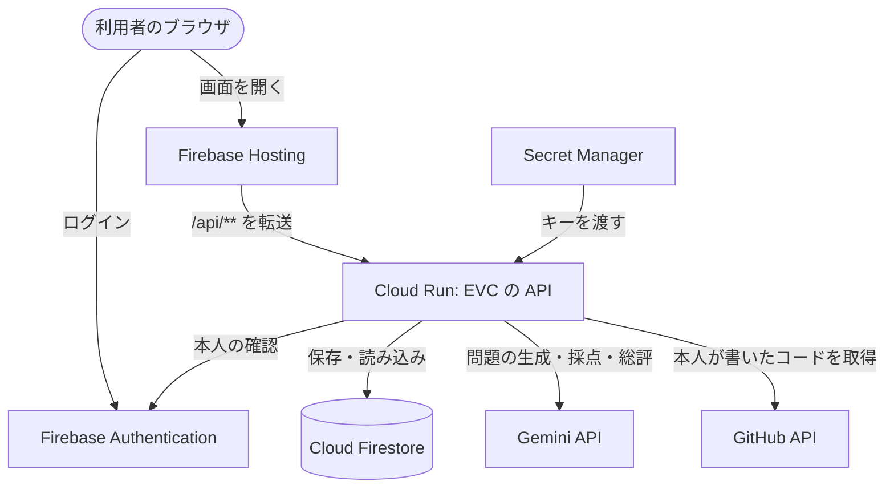

# EVC (Escape VibeCoder)

AI に作らせたコードを「作っただけ」で終わらせないための、コード理解度チェック Web アプリ。

エンジニアは、自分の作ったプロダクトに責任を持たなければならない。AI がコードを書く時代でも、どう動くのかを説明し、問題が起きたときに直せるのは作った人だけです。EVC は、自分のプロダクトを理解するために使います。

GitHub のリポジトリ URL を貼ると、Gemini 3 Flash がログインした本人の書いたコードを題材に問題を作ります。回答すると、コードをどれだけ理解しているかがスコアと総評で分かります。

- 公開中のアプリ: https://evc-gcp.web.app
- 仕様: [docs/spec.md](docs/spec.md)
- 開発ルール: [docs/workflow.md](docs/workflow.md)
- デプロイ: [docs/deploy.md](docs/deploy.md)

DevFest GDGoC Japan Hackathon 2026（カテゴリ: 教育）／チーム t112

## 使い方

1. https://evc-gcp.web.app を開き、GitHub でログインして、利用規約に同意します。
2. 自分がコミットしたことのあるリポジトリの URL を貼ります。コミットが無いリポジトリでは、問題を作れないことが表示されます。
3. 「クイズを作る」を押し、1 問ずつ回答して採点します。
4. スコアと総評を確認し、続けて挑戦します。間違えた場合は類似問題、全問正解の場合は未出題の問題が出ます。
5. 右上のフォルダから「間違えた問題」を開き、問題を選んで記述式で解き直します。70 点以上で解決済みになります。

## 機能

- GitHub でログインして使う。使える人は許可リスト(`ALLOWED_GITHUB_IDS`)で決める。本番は全員に公開している(`*`)
- 行単位の blame で、ログインした本人が書いて今も残っているコードだけを題材に出題する
- 本人のコミットが無いリポジトリでは、URL を入れた時点で知らせ、問題を作らない(API でも拒否する)
- 問題数は本体のコードの総量に応じて 4〜18 問。設定ファイルなど、読んでも意味の薄いファイルは除く。`QUIZ_PROFILE` で固定もできる
- 非公開リポジトリは、API に `PRIVATE_REPOS=on` を付けたときだけ読む(本番では有効)。使う人は GitHub App(EVC)にそのリポジトリを読む許可を出す。Gemini の無料枠では、送ったコードと回答が Google の製品改善に使われることがあるので、非公開のコードを扱うときは有料枠を使う
- 回答は 1 問ずつサーバーに保存。再読み込みすればそのまま続きから解ける。入口の「続きから解く」に出るのは、そのブラウザで最後に使ったクイズだけ(ログアウトすると出なくなる)。ほかのクイズや別の端末では、そのクイズの URL(`?quiz=` 付き)を開けば、入口の画面にそのクイズのボタンが出る
- 選択式は機械採点、記述式は Gemini がルーブリックで採点
- 総合スコア、説明力、AI の詳しい総評
- 間違えたら類似問題、全問正解なら未出題の問題で続けて挑戦
- 間違えた問題はアカウントごとのフォルダに残り、選択式だったものも記述式で一問ずつ解き直す。解決済みと未解決を分けて表示する
- URL の入力時に、リポジトリの有無や公開設定をすぐ確かめる
- スマートフォンでも横スクロールせずにコードを読める。ダーク表示に対応

## 構成



| 領域 | 採用 |
|---|---|
| フロント | React + Vite + TypeScript(`/web`) |
| API | Hono + TypeScript、Cloud Run(`/api`) |
| AI | Gemini 3 Flash(`gemini-3-flash-preview`) |
| データ | Firestore |
| 認証 | Firebase Auth(GitHub でログイン) |
| 配信 | Firebase Hosting |
| 秘密情報 | Secret Manager |

モデルは環境変数 `GEMINI_MODEL` で変えられます。本番は `GEMINI_FALLBACK_MODELS` を空にして、Gemini 3 Flash に固定しています。

## 開発

```sh
npm install
cp .env.example .env        # GEMINI_API_KEY などを設定

npm run dev:api             # API  http://localhost:8080
npm run dev:web             # Web  http://localhost:5173 (/api は API に転送)
npm test                    # API と Web のテスト
npm run typecheck
```

この起動方法では、ログインせずに開発用のユーザーとして使えます(`AUTH` と `VITE_FIREBASE_*` を設定しない場合)。開発用のユーザーは本人を特定できないので、リポジトリ全体から出題します。

Gemini / GitHub を使わずに画面だけ確認したいときは、API の代わりにモックを起動します。

```sh
npm run dev:mock -w api
```

ホストに Node を入れずに、Docker だけで API と Web を起動することもできます(`.env` はそのまま読まれます)。

```sh
docker compose -f compose.dev.yaml up                        # Web http://localhost:5173
API_SCRIPT=dev:mock docker compose -f compose.dev.yaml up    # モックで起動
docker compose -f compose.dev.yaml down                      # 停止
```

Web は `0.0.0.0` で待ち受けるので、同じネットワークや Tailscale の他の端末から `http://<このマシンの IP>:5173` で開けます。

Docker で起動したときは、本番と同じくログインが必要です。ログインには Firebase Auth のエミュレータを使い、本物の GitHub アカウントは使いません。「GitHub でログイン」を押して開いた画面で「Add new account」を選び、架空のアカウントを作ります(作ったアカウントは、止めても残ります)。そのため、非公開リポジトリは読めません。「まだ使えません」の画面を試すときは、`ALLOWED_GITHUB_IDS=1 docker compose -f compose.dev.yaml up` のように、架空のアカウントとは違う ID を許可リストに入れて起動します。

問題の質を確かめるときは検証 CLI を使います。

```sh
npm run eval -w api -- https://github.com/owner/repo [--prompt-only] [--dump]
```
